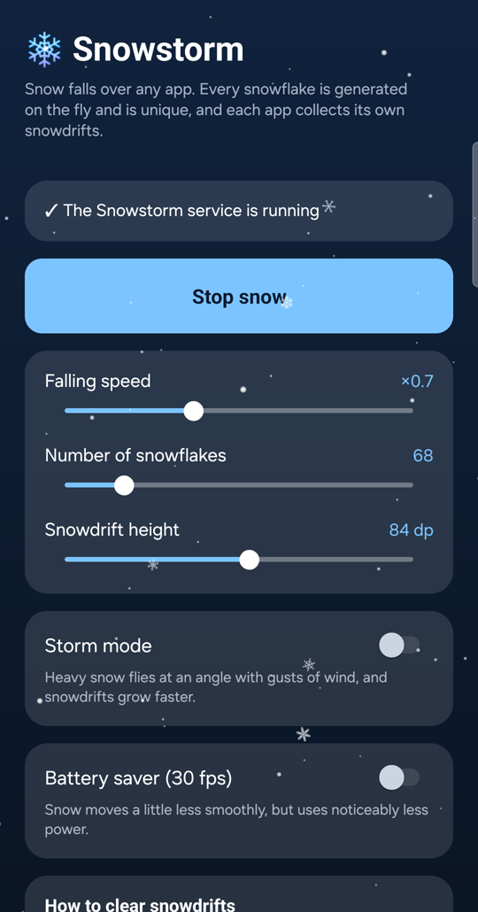

# Snowstorm

[](https://t.me/istratii_tech ) [](https://discord.gg/5HWuRWdKwt)

**Snow falling over your whole Android screen.** Every snowflake is generated on the fly
and is unique. Snowdrifts pile up at the bottom of the app you are using, and each app
keeps its own. Shake the phone, or swipe the app up, and the snowdrift flies apart.

MADE WITH CLAUDE CODE

Repository: `https://github.com/Istratii-tech/Snowstorm`.
Requests and questions: issues of this repository or `https://t.me/istratii_tech`.



## Features

- **Snow over everything:** apps, home screen, Recents and the notification shade. The
  layer never takes your touches.
- **Unique snowflakes:** six-armed crystals with their own arm width, branches, plates,
  tips and centre. Ten kinds are in the air; every 20 seconds five new kinds are drawn
  and five old ones fade out as their last flakes land.
- **Snowdrifts per app:** a snowdrift grows only on the app that is open, with its own
  shape of mounds, and is kept between launches. It rises smoothly from below the bottom
  edge and hides while the notification shade is open.
- **Clearing snowdrifts:** shake the phone, or swipe the app up from the bottom edge (to
  Home or Recents) and the snowdrift flies apart in snowballs.
- **Notification** with **Stop / Start**, **Settings** and **Exit**.
- **Exit** (in the notification or at the bottom of Settings) closes Snowstorm completely:
  snow, notification and background process. Snowdrifts are kept. Android keeps an enabled
  accessibility service running, so Exit also turns the service off; to start again, turn
  Snowstorm on in Accessibility settings.
- **Settings:** falling speed, number of snowflakes, snowdrift height, **Storm mode** (heavy
  snow at an angle with gusts of wind), **Battery saver** (30 fps instead of 60), melt
  all snowdrifts, exit.
- **English and Russian:** follows the system language, or pick one in Settings → Apps →
  Snowstorm → Language (Android 13+).
- Snow stops completely while the screen is off.

## Install

1. Download `Snowstorm-VERSION.apk` from **Releases** and open it on the phone (allow
   installing from this source if asked). Android 8.0 or newer.
2. Open **Snowstorm** and allow notifications.
3. Tap **Open Accessibility settings** → **Installed apps** → **Snowstorm** → turn it on.
   - The switch is greyed out? Android 13+ restricts apps installed from a browser or a
     file manager: Settings → Apps → Snowstorm → ⋮ → **Allow restricted settings**, then
     try again.
4. It's snowing. Shake the phone to shake the snowdrift off.

Tested on a Samsung Galaxy S24 Ultra (Android 17, One UI).

## Privacy

- **No internet permission.** Android does not let the app open any network connection.
- The accessibility service is needed for two things only: drawing over every window, and
  knowing which app is on top (to keep a snowdrift per app). It reads no screen content,
  taps nothing and sends nothing.
- The only data stored is the snowdrift heights per app package and your settings, inside
  the app's own storage.

## Load

The snow layer is redrawn on a fixed schedule: 60 frames per second, or 30 with Battery
saver, and the app sleeps between frames. Measured on the S24 Ultra on the home screen, as
a share of one CPU core: normal mode 36% (20% with Battery saver), Storm mode 49% (29%).

## Build from source

Plain Java with no third-party libraries, built without Gradle:

```bash
./build.sh
```

Needs a JDK (11+) and the Android SDK with `platforms/android-33`, `build-tools/33.0.2` and
`build-tools/35.0.0-rc4` (`ANDROID_HOME`, default `~/Library/Android/sdk`). The APK is
`build/Snowstorm.apk`, signed with a local `debug.keystore` created on the first build.

## Инструкция

**Снег поверх всего экрана Android.** Каждая снежинка генерируется на лету и уникальна. Внизу
открытого приложения копятся сугробы, у каждого приложения свои. Встряхните телефон или смахните
приложение вверх — сугроб разлетится.

1. Скачайте `Snowstorm-ВЕРСИЯ.apk` из **Releases** и откройте его на телефоне (если спросит —
   разрешите установку из этого источника). Нужен Android 8.0 или новее.
2. Откройте **Snowstorm** и разрешите уведомления.
3. Нажмите **«Открыть спец. возможности»** → «Установленные приложения» → **Snowstorm** → включить.
   - Переключатель серый? Android 13+ ограничивает приложения, установленные из браузера или
     файлового менеджера: Настройки → Приложения → Snowstorm → ⋮ → **«Разрешить ограниченные
     настройки»**, затем снова включите.
4. Снег пошёл.

**Что умеет:**
- снег поверх приложений, рабочего стола, «Недавних» и шторки; касания проходят насквозь;
- уникальные снежинки: в воздухе 10 видов, каждые 20 секунд появляются 5 новых, а 5 старых
  постепенно уходят;
- свой сугроб у каждого приложения; растёт только у открытого, сохраняется между запусками;
- убрать сугроб: встряхнуть телефон или смахнуть приложение вверх от нижнего края;
- уведомление с кнопками «Остановить/Запустить», «Настроить» и «Выйти»;
- «Выйти» (в уведомлении или внизу настроек) полностью закрывает Snowstorm: снег, уведомление
  и фоновый процесс. Сугробы сохраняются. Включённую службу спец. возможностей Android держит
  запущенной, поэтому выход выключает и её; чтобы запустить снова, включите Snowstorm в
  «Спец. возможностях»;
- настройки: скорость, количество снежинок, высота сугробов, режим «Шторм», экономный режим
  (30 к/с), «Растопить все сугробы», «Выйти»;
- русский и английский: по языку системы или отдельно в Настройки → Приложения → Snowstorm → Язык.

**Приватность:** у приложения нет разрешения на интернет. Служба спец. возможностей только рисует
слой со снегом и узнаёт, какое приложение сверху; содержимое экрана она не читает, ничего не
нажимает и никуда не отправляет.

## License

GNU Affero General Public License v3.0, see `LICENSE`.
